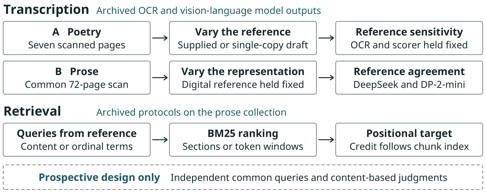
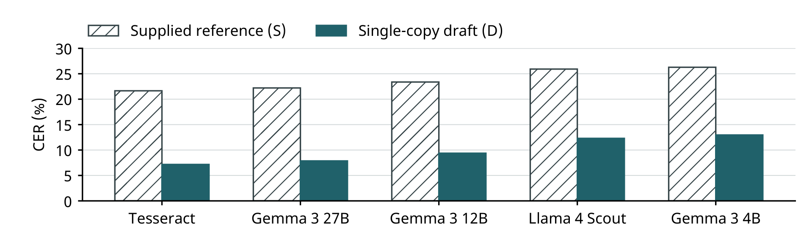
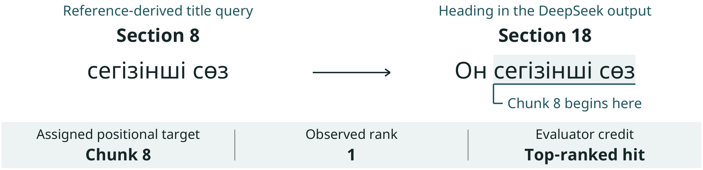

# What OCR Scores Conceal: Reference Integrity, Text Representation, and Retrieval Diagnostics for Printed Kazakh Book OCR

This repository provides reproducible code, aggregate evidence, and figure-generation assets for examining the reliability of OCR evaluation on printed Kazakh books.

The study investigates reference integrity in poetry, reference agreement and text-representation sensitivity in prose, and failure modes in legacy positional-target retrieval evaluation. It distinguishes reference-distance measurements from absolute OCR accuracy and diagnostic retrieval records from evidence of retrieval effectiveness.

## Visual Overview

Select a preview to inspect its full resolution. Each preview is rendered directly from the corresponding authoritative vector PDF at 300 dpi. The figures are stacked to preserve label readability.

### Figure 1 — Evaluation pipeline

*Archived transcription and retrieval analyses. In A the OCR hypotheses stay fixed as the poetry reference changes. The paired B analysis uses DeepSeek and DP-2-mini on a common scan. Tesseract's separate B export provides a heterogeneous-source baseline. The dashed strip shows the prospective retrieval design, for which no performance scores are reported*

[View vector PDF](figures/Fig1_pipeline.pdf)

### Figure 2 — Reference sensitivity

*Full-document CER for each unchanged poetry transcription. Hatched bars at left use the supplied reference (S). Solid bars at right use the provisional single-copy draft (D). Table 1 lists the percentages*

[View vector PDF](figures/Fig2_reference_sensitivity.pdf)

### Figure 3 — Positional-target failure trace

*DeepSeek title-query trace in the legacy section protocol (S2). The underline marks the substring accepted as heading 8 inside the compound ordinal for 18. The arrow shows the positional assignment. Ranking chunk 8 first earns credit regardless of which section begins there*

[View vector PDF](figures/Fig3_positional_target.pdf)

## What this package reproduces

The public checks verify saved edit-count arithmetic, reproduce seven-page conditional resampling ranges from per-page counts, inspect representation sensitivity, generate the final figures, and test prospective evaluator contracts. Fresh alignments, historical BM25 rankings and source-page observations require separately authorized inputs.

| Final manuscript material | Public evidence and command | Requires restricted inputs for |
|---|---|---|
| Table 1 and Figure 2, A S/D reference sensitivity | code/reproduce.py verify; results/benchmark_a/primary_S_D_counts.csv and reference_sensitivity.csv | Fresh alignment of exact reference/output texts |
| Table 2, A page-additive scores and ranges | verify recomputes 2,000 shared page draws with seed 20260602 from page_counts.csv | Recomputing the per-page counts |
| Table 3, B reference distances and conditional edit-bin ranges | verify checks count/rate consistency; results/benchmark_b/qara_sozder_bootstrap_ci.csv preserves ranges | Fresh B alignments and 45-bin, 500-draw ranges |
| Table 4, B character operations | verify checks preserved counts and source-window arithmetic | Recomputing S/D/I from book text |
| Table 5, paired representation sensitivity | code/release_checks.py checks all eight rows and four gaps in analysis/results.json | analysis/representation_sensitivity.py realigns the exact three common-scan reference/output texts |
| Table 6, legacy BM25 diagnostics | verify checks nine archived records | Recreating reference-derived queries and positional rankings |
| Figures 1–3 | code/reproduce.py figures regenerates the three final vector figures in work/ | Independently re-establishing the source observation depicted in Figure 3 |
| Exploratory symbol localization | analysis/results.json records 3,991 of 5,431 insertions in three spans | Exact outputs for alignment; raw DP extraction for page-grounding corroboration |
| Saved correction paragraph | results/correction/saved_correction_scores.json | Exact five saved reference/correction texts |
| Prospective evaluator | Eleven synthetic tests and an intentionally blocked empty template | Real queries and content judgments are absent |

Table numbers refer to the final six-table manuscript. Figure 3 is the heading/target trace. The superseded MRR bar chart is excluded.

## Environment

Use Python **3.12**, tested with **3.12.1**. The pinned packages are RapidFuzz 3.14.6, NumPy 2.4.4, Matplotlib 3.10.9, ReportLab 5.0.0 and PyMuPDF 1.28.0.

RapidFuzz is required for optional archived-text scoring. NumPy, Matplotlib and ReportLab support figure generation. PyMuPDF renders and verifies the README previews. Aggregate arithmetic and the synthetic evaluator tests use the standard library. The Noto Sans Regular and Bold fonts are included with their original license notices.

Create an environment using your normal Python environment manager, activate it, and install the declared dependencies.

    python -m pip install -r requirements.txt

The dependency versions were tested using an existing local installation. A fresh network installation and other operating systems were not tested. No OCR engine, model weights, GPU, TeX installation, API credential or cloud account is needed for public checks.

## Run the public checks

Run the following commands from the package root in this order. They write only below work/, which is excluded from the staged inventory. Use -B to suppress Python cache files.

    python -B code/reproduce.py environment --output work/environment.json
    python -B code/reproduce.py verify --output work/aggregate_verification.json
    python -B code/release_checks.py --output work/release_checks.json
    python -B code/reproduce.py figures --output work/figures
    python -B code/render_readme_previews.py --output work/readme_previews
    python -B -m unittest discover -s code/prospective -p "test_*.py" -v
    python -B code/reproduce.py gate --output work/prospective_gate.json

Expected outcomes are PASS and exit 0 for the checks and figure commands, and 11 tests with OK. The final gate command intentionally produces status BLOCKED, performance_metrics null and expected_blocked_template true, with wrapper exit 0. It confirms that an empty prospective template emits no empirical retrieval scores.

The figure command uses the unchanged final generator in a temporary copy and writes three PDFs to work/figures. It leaves the authoritative PDFs under figures/ untouched. The preview command writes three PDF-derived PNGs under work/readme_previews. The staged previews under figures/readme/ are checked against those same PDF pages.

MANIFEST.json identifies every staged file except itself and the local generated work/ contents. It includes each file's hash, source classification and addition rationale. It also records the source-PDF and generated-PNG hashes for the three README previews. A manifest verifies integrity; it does not grant reuse rights.

## Optional archived-output replay

Read [SOURCE_ACCESS.md](SOURCE_ACCESS.md). The package contains no book scan, full reference, OCR output, source download mechanism or promised external-access service.

The 15 portable input aliases, exact byte hashes and original repository-relative names are in [metadata/restricted_inputs.json](metadata/restricted_inputs.json). The repository-relative names are provenance labels. Public commands do not resolve them on the maintainer's machine.

Place separately authorized copies outside this package, using a sibling directory.

    ../authorized_inputs/
        benchmark_a/
        benchmark_b/
        correction/

Create the filenames listed by the input_path fields. Then run:

    python -B code/reproduce.py evaluate --input-root ../authorized_inputs --output work/archived_evaluation.json

Missing or mismatched files produce BLOCKED, exit 2 and no performance metrics. The adapter accepts only the preserved hashes. It does not evaluate substitute editions as replacements for the archived evidence.

For the three-input paired representation check:

    python -B analysis/representation_sensitivity.py --release . --input-root ../authorized_inputs --output work/representation_replay.json

This preserves the exact crop, normalization and unit-cost alignment procedure. It requires RapidFuzz 3.14.6. The optional --dp-json argument accepts a separately authorized raw extraction identified by its recorded digest. It corroborates page grounding. It is unnecessary for the representation distances and does not convey access rights.

Historical OCR inference and external spelling services cannot be reconstructed merely by replaying stored output evaluation. This package makes no service calls.

## Evidence boundaries

**Benchmark A.** S is the defective supplied reference. D removes the first incomplete 35-line copy while retaining the complete occurrence. D is a provisional sensitivity target with residual transcription issues. C is a separate, partial one-reader collation with 39 candidate edits. It is excluded. The 21.65% to 7.17% Tesseract CER change measures reference sensitivity with identical OCR output. Full-document and page-additive denominators differ.

**Benchmark B.** Existing metadata reasonably support a common 72-page scan for DeepSeek and DP-2-mini. The 43-page digital reference differs from the scan in identified passages. Tesseract's 219-page export has a heterogeneous scope, including glossary/notes and postmatter. Its source images are unavailable. The reported CER/WER quantify reference agreement. They do not establish absolute OCR accuracy or a controlled same-image ranking against Tesseract.

**Representation sensitivity.** The first three representations align characters. Joined lowercase WER-token strings jointly change punctuation, separators, reference length and optimal alignment. The fourth representation aligns words. Gaps use DP-2-mini minus DeepSeek before rounding. The selected repeated-symbol spans contain 3,991 of 5,431 insertions in one optimal alignment. All spans remained in the scored output, and the extraction cause is unknown.

**Retrieval.** The nine historical records are failure diagnostics. The heading parser, positional targets, unequal query sets and reference-derived queries prevent retrieval-effectiveness conclusions. Synthetic tests exercise software contracts. The prospective evaluator has no independent real queries or content judgments.

**Correction.** Saved correction outputs cover one sample against defective S. They provide no evidence of general service performance or supported Kazakh cloud correction.

## Package guide

- code/ contains the frozen scoring bodies, portable adapter and prospective tests.
- analysis/ contains the paired representation script and preserved numeric receipt.
- results/ contains aggregate records for A, B and saved correction.
- metadata/ contains input identities, numeric source correspondences and qualified provenance.
- figures/ contains the authoritative PDFs, current generator, numeric plotting inputs, fonts and README previews.
- templates/ contains the empty prospective evaluator bundle.
- validation/ contains release test and exclusion receipts.

[Included-file manifest](MANIFEST.json) · [Staging provenance and additions](STAGING_PROVENANCE.json) · [Validation receipt](validation/release_validation.json) · [Exclusion verification](validation/EXCLUSION_VERIFICATION.md)

## Citation and reuse

Use [CITATION.cff](CITATION.cff) for the staged software/artifact package and associated manuscript metadata. The software record lists the two repository contributors. Its preferred manuscript citation preserves the approved title and all six scholarly authors. The existing repository URL is recorded; no DOI or publication date is assigned.

No project-wide reuse license has been assigned. See [RIGHTS_AND_REUSE.md](RIGHTS_AND_REUSE.md) and [DATA_POLICY.md](DATA_POLICY.md) for permissions, reuse conditions, and data exclusions.
